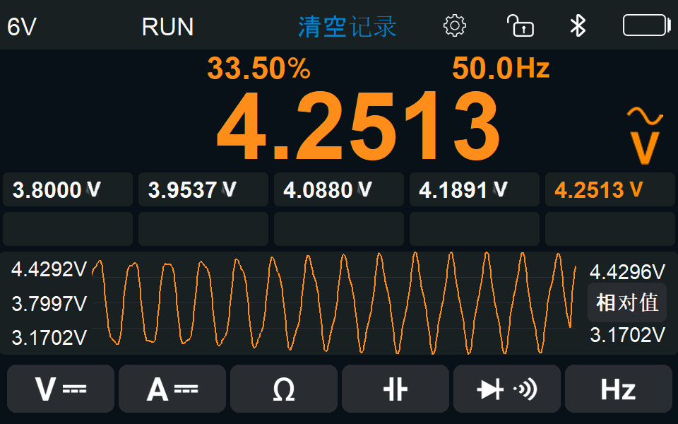
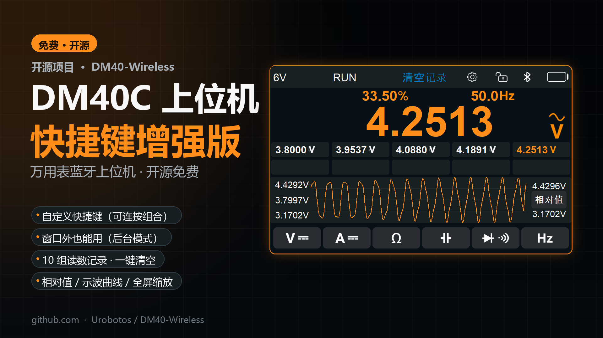

> **致谢 / Credits**：本项目基于 **[Urobotos/DM40-Wireless](https://github.com/Urobotos/DM40-Wireless)**（原作者 **Urobotos**）二次开发，感谢原作者开源与协议整理。原项目地址：https://github.com/Urobotos/DM40-Wireless

# DM40 Wireless 上位机 · 快捷键增强版

DM40 Wireless — Alientek DM40 万用表蓝牙上位机（快捷键增强分支）

<p align="center">
  
</p>

<p align="center">
  
</p>

<p align="center">
  <b>⬇ 下载 Windows 版 / Download</b>：
  <a href="https://github.com/htlgg/dm40-Host-computer/releases/download/v1.0.0/DM40-Wireless-Win64-v1.0.0.zip">
    DM40-Wireless-Win64-v1.0.0.zip
  </a>
  （21.5 MB，解压后双击 <code>DM40 Wireless.exe</code>，无需安装 Python）
</p>

---

## 中文

### 这是什么

Windows 桌面端上位机，通过**蓝牙 BLE** 连接正点原子 **DM40A / DM40B / DM40C** 万用表，
界面 1:1 还原表盘显示（档位、量程、HOLD、辅助显示、示波曲线），并在此基础上加入了
快捷键、读数记录、窗口缩放等增强功能。

### 本分支新增功能

| 功能 | 说明 |
| --- | --- |
| **自定义快捷键** | 设置页里逐项改键，支持两键连按组合（如 `0` 然后 `1`）、逐项开关、一键恢复默认 |
| **窗口外也能用** | 后台键盘钩子，焦点在别的软件时快捷键照样生效；切换模式有提示音（音量 0–100%、开/关音效可分别设置） |
| **读数记录 10 组** | 一键保存到记录格、一键清空，都有默认快捷键 |
| **相对值快捷键** | 不用点按钮，一个键切换 REL 开/关 |
| **窗口缩放 / 全屏** | 拖边框自适应重绘（保留读数与记录），`Alt+Enter` 全屏 |
| **蓝牙连接修复** | 修复"系统能搜到、软件说没开蓝牙"的误判；**搜索会列出全部设备**，还支持**手动输入地址**连接 |
| **RAW 协议控制台** | 实时查看 TX/RX 报文与 CRC 校验结果 |
| **迷你窗口 / 深色标题栏 / 单实例保护** | 小窗模式只留读数与功能组；重复启动只保留一个实例 |

### 快速开始

**方式一：直接运行（推荐给普通用户）**

1. 下载 [DM40-Wireless-Win64-v1.0.0.zip](https://github.com/htlgg/dm40-Host-computer/releases/download/v1.0.0/DM40-Wireless-Win64-v1.0.0.zip)
2. 解压到任意目录，双击 `DM40 Wireless.exe`（无需安装 Python）

**方式二：从源码运行**

```bat
pip install -r requirements.txt
python app.py
```

或者双击 `install.bat` 建环境，再双击 `app.pyw`（不弹控制台）。

### 连接仪表

1. 在万用表上打开蓝牙
2. 软件里点右上角蓝牙图标 → 进入「连接」页 → 点 **搜索**
3. 列表里 DM40 排在最前，选中后点 **连接**（之后会自动记住地址）

**搜不到怎么办？**

- 列表里带「未识别」的设备也可以选（已被 Windows 配对过的表常常不再广播 DM40 名字）
- 还不行就点 **手动输入**，填 `AA:BB:CC:DD:EE:FF` 格式的地址
  （Windows 设置 → 蓝牙和设备 → 更多蓝牙设置 里能查到）

### 默认快捷键

| 动作 | 默认键 | 动作 | 默认键 |
| --- | --- | --- | --- |
| 下一挡位 | `Tab` | 保存读数 | `F7` |
| 上一挡位 | `Shift+Tab` | 清空记录 | `F9` |
| 自动量程 (AUTO) | `A` | 保持 / 运行 | `F8` |
| 超级自动 (AUTO+) | `P` | 相对值 开/关 | `R` |
| 定档 1–9 | `1`–`9` | 窗口外模式开关 | `F11` |
| 功能组 1–6 | `F1`–`F6` | 全屏 / 窗口 | `Alt+Enter` |
| 返回 | `Esc` | | |

所有键都可以在 **设置 → 快捷键** 里改，改完立即生效。

### 目录结构

```
app.py / app.pyw      入口（pyw 不弹控制台）
ble/                  蓝牙扫描、连接、协议收发
core/                 数据解析、配置、多语言
gui/                  界面（Tkinter Canvas 手绘）
i18n/                 界面语言（中文 / 繁中 / 英文 / 德文 / 捷克文）
images/               图标与素材
preview/              预览图
tests/                自动化测试（直接 python 运行）
settings.example.json 默认配置示例
```

### 打包成 exe

```bat
pip install pyinstaller
build_exe.bat
```

输出在 `dist\DM40 Wireless\`，整个文件夹即为绿色版。

### 许可

MIT，见 [LICENSE](LICENSE)。可自由使用、修改、分发（保留版权声明）。

---

## English

### What is this

A Windows desktop application that talks to the **Alientek DM40** series multimeter
(DM40A / DM40B / DM40C) over **Bluetooth Low Energy**. The UI mirrors the device
display and adds a hotkey layer on top of it.

### What this fork adds

- **Configurable hotkeys** — rebind every action in Settings, per-row on/off
  switches, two-key chords, one-click reset to defaults.
- **Background mode** — a low-level keyboard hook keeps the shortcuts working
  while another window is focused, with a configurable confirmation tone
  (volume, separate on/off effects, or mute).
- **Reading memory** — 10 save slots with one-key save / clear.
- **Relative-value hotkey** — toggle REL without the mouse.
- **Resizable window / full screen** — the UI is redrawn at the new scale and
  keeps the readings and saved values; `Alt+Enter` toggles full screen.
- **Bluetooth fixes** — the radio check no longer reports "off" because of a
  stale virtual adapter, scans list every nearby device, and an address can be
  typed by hand.
- RAW protocol console, mini mode, dark title bar, single-instance guard.

### Getting started

Download `DM40-Wireless-Win64-v1.0.0.zip` from the
[latest release](https://github.com/htlgg/dm40-Host-computer/releases/latest)
and run `DM40 Wireless.exe`, or run from source:

```bat
pip install -r requirements.txt
python app.py
```

### Default hotkeys

| Action | Key | Action | Key |
| --- | --- | --- | --- |
| Next range | `Tab` | Save reading | `F7` |
| Previous range | `Shift+Tab` | Clear readings | `F9` |
| Auto range | `A` | Hold / Run | `F8` |
| Auto+ range | `P` | Relative on/off | `R` |
| Range 1–9 | `1`–`9` | Background mode | `F11` |
| Function group 1–6 | `F1`–`F6` | Full screen | `Alt+Enter` |
| Back | `Esc` | | |

### Troubleshooting

- **The meter is not listed** — every nearby BLE device is shown; pick one marked
  as unknown if your meter stops advertising its DM40 name, or use **Manual**
  and type the address.
- **"Turn on Bluetooth" while Windows finds the meter** — fixed in this fork; if
  it still happens, check that at least one Bluetooth adapter is healthy in
  Device Manager.

### License

MIT — see [LICENSE](LICENSE).

---

## 原项目文档 / Upstream documentation

完整的协议说明、Linux 支持、历史版本说明请见原作者仓库：
**[Urobotos/DM40-Wireless](https://github.com/Urobotos/DM40-Wireless)**
