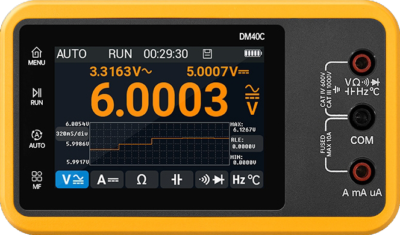
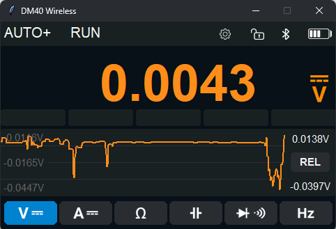
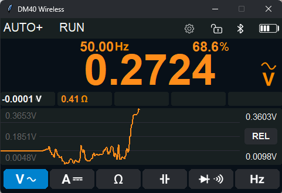
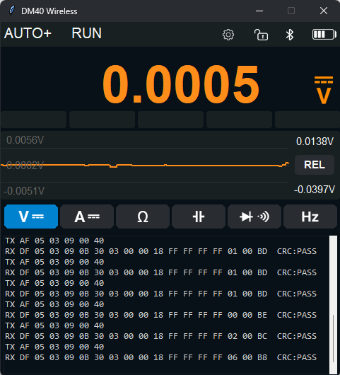
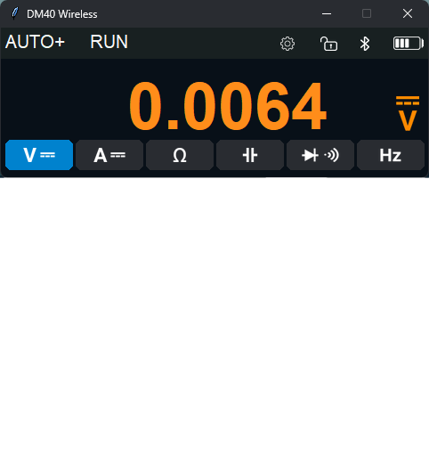
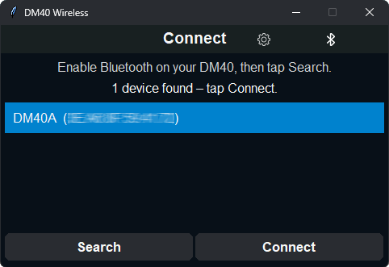
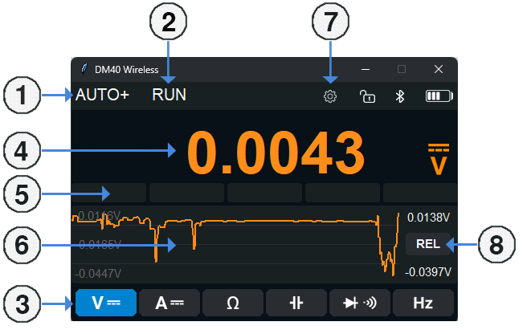
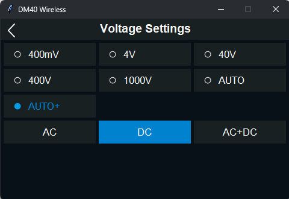
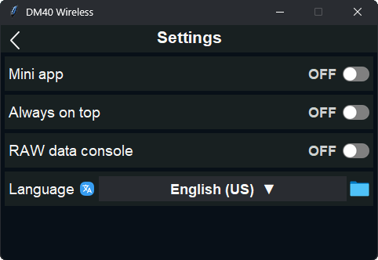
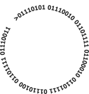

# DM40 Wireless

<p align="center" width="100%">
    
</p>

A Windows and Linux desktop app that connects over **Bluetooth Low Energy (BLE)** to the wireless **Alientek DM40** multimeter (DM40A, DM40B, DM40C). The UI mirrors the device display, including measurement modes, ranges, HOLD, and saved values.

**Repository:** [github.com/Urobotos/DM40-Wireless](https://github.com/Urobotos/DM40-Wireless)

| Branch     | Purpose                                     |
| ---------- | ------------------------------------------- |
| `main`     | Stable releases matching GitHub Releases    |
| `develop`  | Active development, new features and fixes  |

## Preview

<p align="center">
  
</p>

<p align="center">
  
</p>

## What this fork adds

- **Customisable hotkeys** – rebind every action in Settings → Keyboard
  shortcuts, per-row on/off switches, and two-key chords (`0` then `1`).
- **Background mode** – a low-level keyboard hook keeps the shortcuts working
  while another window is focused; a confirmation tone (volume + on/off sound
  effects) can be configured or muted.
- **Reading memory** – 10 save slots, one-key save, one-key clear.
- **Relative value shortcut** – toggle REL without touching the mouse.
- **Resizable window / full screen** – the UI is redrawn at the new scale and
  keeps the readings, save slots and current mode.
- **Bluetooth fixes** – the radio check no longer fails because of a stale
  virtual adapter; scans list every device and an address can be typed by hand.
- Dark native title bar, mini mode, and a RAW protocol console.

<br>


---

## Bluetooth discovery

- A scan lists every nearby BLE device: DM40 models first, everything else is
  marked as unknown but stays selectable (useful for a meter Windows already
  paired, which then stops advertising its DM40 name).
- **Manual** takes a Bluetooth address typed by hand (AA:BB:CC:DD:EE:FF).
- The radio check now reports *off* only when every Bluetooth device is in an
  error state – a leftover virtual adapter used to hide a working one.

## Requirements:

- **Alientek DM40** multimeter (A / B / C) within range
- **Windows 10/11** or **Linux** with `BlueZ` stack
- **Bluetooth Low Energy (BLE)** — available for Bluetooth versions 4.0+ 

<br>

---

## Bluetooth discovery

- A scan lists every nearby BLE device: DM40 models first, everything else is
  marked as unknown but stays selectable (useful for a meter Windows already
  paired, which then stops advertising its DM40 name).
- **Manual** takes a Bluetooth address typed by hand (AA:BB:CC:DD:EE:FF).
- The radio check now reports *off* only when every Bluetooth device is in an
  error state – a leftover virtual adapter used to hide a working one.

## Running from Windows (Installation for end users):

1. Open [Releases](https://github.com/Urobotos/DM40-Wireless/releases) on GitHub and download **`DM40-Wireless-win64.zip`**
2. Extract the zip to any folder (e.g. `C:\Apps\DM40 Wireless\`)
3. Run **`DM40 Wireless.exe`** <br><br>
4. On first launch, the **Connect** screen appears — search for your meter, select it in the list, and click **Connect**. <br>
   The MAC address is saved to `settings.json` next to the exe, on the next launch the app connects automatically.

<br>

> The App runs only from the extracted folder — **it does not install**. <br>
> Do not move the `DM40 Wireless.exe` file outside its own folder, instead you can create a shortcut on your desktop.

<br>

## Bluetooth discovery

- A scan lists every nearby BLE device: DM40 models first, everything else is
  marked as unknown but stays selectable (useful for a meter Windows already
  paired, which then stops advertising its DM40 name).
- **Manual** takes a Bluetooth address typed by hand (AA:BB:CC:DD:EE:FF).
- The radio check now reports *off* only when every Bluetooth device is in an
  error state – a leftover virtual adapter used to hide a working one.

## Running on Linux (end users):

- Install system dependencies (Tkinter):
  - For CachyOS / Arch Linux:
  ```bash
  sudo pacman -S tk
  ```
  - For Ubuntu / Debian:
  ```bash
  sudo apt install python3-tk
  ```

- Download the DM40-Wireless repository and enter the folder:
```bash
git clone git@github.com:Urobotos/DM40-Wireless.git
cd DM40-Wireless
```

- Create and activate virtual environment (venv):
```bash
python3 -m venv .venv
source .venv/bin/activate
```

- Install Python packages inside venv:
```bash
python -m pip install --upgrade pip
python -m pip install -r requirements.txt
```

- On first run, copy the settings template:
```bash
cp settings.example.json settings.json
```

- Then run the app by:
```bash
python app.py
```


<br>

---

## Bluetooth discovery

- A scan lists every nearby BLE device: DM40 models first, everything else is
  marked as unknown but stays selectable (useful for a meter Windows already
  paired, which then stops advertising its DM40 name).
- **Manual** takes a Bluetooth address typed by hand (AA:BB:CC:DD:EE:FF).
- The radio check now reports *off* only when every Bluetooth device is in an
  error state – a leftover virtual adapter used to hide a working one.

## App Screenshots:

<p style="text-align: left">
    
    
    
    
</p>

<br>

---

## Bluetooth discovery

- A scan lists every nearby BLE device: DM40 models first, everything else is
  marked as unknown but stays selectable (useful for a meter Windows already
  paired, which then stops advertising its DM40 name).
- **Manual** takes a Bluetooth address typed by hand (AA:BB:CC:DD:EE:FF).
- The radio check now reports *off* only when every Bluetooth device is in an
  error state – a leftover virtual adapter used to hide a working one.

## Using the app:

### Connect screen (first launch / empty MAC):



- **Search** — scan for nearby DM40 BLE devices
- Click a list row — select a device
- **Connect** — save MAC and model, connect, and go to the main screen
- ⚙️ In the **Settings** you can change the language | ⚙️ 在**设置**中，您可以更改语言。

### Main screen:

<p style="text-align: left">
    
</p>

| Area                   | Action                                                                                                  |
| ---------------------- | ------------------------------------------------------------------------------------------------------- |
| **1. AUTO+**           | Opens the **RANGE screen** menu for the current mode (Clickable)                                        |
| **2. RUN / HOLD**      | Toggles measurement hold (Clickable)                                                                    |
| **3. MODE buttons**    | Cycle sub-modes: VDC/VAC, ADC/AAC, OHM, CAP, DIODE/CONT, Hz/TEMP                                        |
| **4. Display digits**  | Main display digits                                                                                     |
| **5. Save slots**      | Click on the **display digits** to save values to slots (**10 slots, 2 rows**); hold on the digits, press the top-bar **Clear** button or `F9` to clear them |
| **6. Graph**           | Live measurement plot (hidden in Mini app mode), hold in the graph area to clear it                     |
| **7. Settings** ⚙️     | Opens **Settings screen**                                                                               |
| **8. REL button**      | REL = **Relative mode**, click to set, hold button to cancel                                            |

Connection status, meter battery, and units are shown in the top bar from live BLE data.

### RANGE screen:



- List of ranges for the current measurement mode (depends on DM40A/B/C model)
- ❮ **Back** — return to the main screen

### Keyboard shortcuts:

Range (挡位) switching works without touching the mouse — the keys are handled
by the window, so no widget needs focus. Defaults:

| Key                | Action                                                            |
| ------------------ | ----------------------------------------------------------------- |
| **Tab**            | Next range of the active mode (600mV → 6V → 60V → … → AUTO → AUTO+) |
| **Shift + Tab**    | Previous range                                                    |
| **1 … 9**          | Jump straight to range N, in the order shown on the RANGE screen   |
| **A**              | AUTO range                                                        |
| **P**              | AUTO+ range                                                       |
| **F7**             | Save the current reading to a slot (same as clicking the digits)  |
| **F8**             | Toggle RUN / HOLD (same as clicking the top-bar HOLD area)        |
| **F9**             | Clear all saved readings (same as the top-bar 清空 button)        |
| **F11**            | Toggle **background mode** – shortcuts also work in other apps    |
| **Alt + Enter**    | Toggle full screen (the UI scales to fit, letterboxed)             |
| **F1 … F6**        | Cycle the MODE group, same as clicking the MODE button            |
| **Esc**            | Back out of RANGE / SETTINGS / KEYBOARD                           |

**Every key can be changed** in **Settings → Keyboard shortcuts**:

- Click a row, then press the new key — the top-row switch enables/disables the
  whole feature, **Restore defaults** puts the table back.
- Every row has **its own switch** on the left. Switch one off and that shortcut
  stops working, **its key is cleared**, and the row **disappears from the list**
  (no dead rows to scroll through). The hint line then shows **Show off (N)** to
  bring them back; a re-enabled row starts without a key, ready to be assigned.
- `Delete` / `BackSpace` clears a binding (the action then has no key),
  `Esc` cancels the capture.
- Assigning a key that is already taken **swaps** the two actions instead of
  silently dropping one.
- Modifiers work too: `Ctrl+1`, `Alt+F2`, `Ctrl+Shift+R`, …
- **Background mode** (Settings → Keyboard shortcuts → *Work in background*):
  with it on, **every** shortcut also fires while another window is focused,
  using a low-level keyboard hook. `F11` toggles the mode from anywhere (a short
  beep confirms on/off). A key that matches an enabled shortcut is **swallowed**
  (`global_swallow`, default on) so it cannot leak into the focused window –
  the desktop and some IMEs answer digit keys with a system beep. Turn the mode
  off to type those keys normally again; keys that are not bound still pass
  through untouched.
- **Two-key chords**: while a row is armed press two keys in a row (`0` then `1`)
  and the shortcut becomes **`0 → 1`** — press `0`, then `1` within 1.5 s to run
  it. `Enter` keeps only the first key, and the capture times out to a single key
  if no second key follows. Only plain keys (letters, digits, `Tab`, …) can start
  a chord, so double-tapping `F5` never turns into one by accident.
- Overrides are stored in `settings.json` → `hotkey_map`, switched-off rows in
  `hotkey_disabled` (only non-default entries are written).

Notes:

- Ranges are per mode: `600mV 6V 60V 600V 1000V` for voltage, `600uA … 10A` for
  current, `600Ω … 60MΩ` for resistance (labels follow the DM40A/B/C model) —
  so the same key maps to whatever that mode offers.
- Modes without selectable ranges (CAP, DIODE, CONT, Hz, TEMP) ignore the range keys.
- The top-bar range label updates instantly and briefly highlights; the meter
  remains the source of truth and overwrites it on the next frame.
- Keys are ignored while a text field has focus (RAW console, language popup),
  so typing still works.
- **Window scaling**: drag the window border to resize — the whole UI is redrawn
  at the new scale (aspect ratio kept, save slots and readings preserved).
  `Alt+Enter` switches to full screen. The scale is stored in `window_scale`.
- **Alert sound** (Settings → Keyboard shortcuts → *Alert sound*): on/off,
  volume 0–100 %, and four effects (single / double / chime / tick), with a
  preview button. The tones are synthesised at runtime – no audio files.
- If something behaves oddly, `dm40-diagnostics.log` next to the exe records
  shortcut toggles and actions fired from the background hook.

### Settings screen:



| Setting                 | Function                                                                                                                 |
| ----------------------- | ------------------------------------------------------------------------------------------------------------------------ |
| **Mini app**            | Smaller window without graph and save slots                                                                              |
| **Always on top**       | Keep the window above other apps                                                                                         |
| **RAW data console**    | Panel below the UI showing BLE TX/RX packets (protocol debugging)                                                        |
| **Keyboard shortcuts**  | Opens the shortcut editor: on/off switch, one row per action, remap by pressing a key                                    |
| **Language**            | Tap the current language to pick from installed `.toml` files. The folder icon opens `i18n\` for custom translations     |

Changes are saved to `settings.json`.

<br>

---

## Bluetooth discovery

- A scan lists every nearby BLE device: DM40 models first, everything else is
  marked as unknown but stays selectable (useful for a meter Windows already
  paired, which then stops advertising its DM40 name).
- **Manual** takes a Bluetooth address typed by hand (AA:BB:CC:DD:EE:FF).
- The radio check now reports *off* only when every Bluetooth device is in an
  error state – a leftover virtual adapter used to hide a working one.

## Running from source (developers):

- Requirements to run from source: **Python 3.11+** ([python.org](https://www.python.org/)) — check **`Add python to PATH`** during installation

```powershell
# Windows PowerShell:

git clone -b develop https://github.com/Urobotos/DM40-Wireless.git
cd DM40-Wireless
.\install.bat
```

*(* `install.bat` *creates* `.venv`*, installs dependencies from* `requirements.txt`*, and installs* `Nuitka` *for building )* <br><br>

On first run, copy the settings template:

```powershell
copy settings.example.json settings.json
```

<br>
Then start the app using one of these:

| Method                       | Description                                                                          |
| ---------------------------- | ------------------------------------------------------------------------------------ |
| **`DM40 Wireless.bat`**      | Recommended (Windows clickable) - runs `app.pyw` without a console                   |
| **`app.py`**                 | PowerShell cmd: `.\.venv\Scripts\python.exe app.py` - with console (debugging, logs) |

<br>

Self-checks (no meter needed):

```powershell
.\.venv\Scripts\python.exe tests\test_hotkeys.py   # range tables, cycling, CRC
.\.venv\Scripts\python.exe tests\smoke_gui.py      # opens a window, fires key events
```

<br>

---

## Bluetooth discovery

- A scan lists every nearby BLE device: DM40 models first, everything else is
  marked as unknown but stays selectable (useful for a meter Windows already
  paired, which then stops advertising its DM40 name).
- **Manual** takes a Bluetooth address typed by hand (AA:BB:CC:DD:EE:FF).
- The radio check now reports *off* only when every Bluetooth device is in an
  error state – a leftover virtual adapter used to hide a working one.

## Configuration (`settings.json`):

The file lives next to the exe or in the project root. It is not committed to git — use `settings.example.json` as a template.

| Key              | Meaning                                                                                      |
| ---------------- | -------------------------------------------------------------------------------------------- |
| `target_mac`     | DM40 MAC address (empty `""` show Connect screen)                                            |
| `model_name`     | `DM40A`, `DM40B`, or `DM40C`                                                                 |
| `device_counts`  | Range count scale (40k / 50k / 60k)                                                          |
| `window_scale`   | Window scale (`1.0` = 480×300 logical px)                                                    |
| `mini_app`       | Mini mode (boolean: false / true)                                                            |
| `always_on_top`  | Always on top (boolean: false / true)                                                        |
| `raw_console`    | RAW console (boolean: false / true)                                                          |
| `hotkeys`        | Range / mode keyboard shortcuts (boolean: false / true, default `true`)                       |
| `hotkey_map`     | Shortcut overrides, Tk syntax (`{"range_next": "Control-Tab"}`); chords are space separated (`{"mode_1": "0 1"}`) |
| `hotkey_disabled`| Shortcut ids switched off in the editor, e.g. `["range_index_9", "mode_6"]`                  |
| `language`       | UI language code matching a file in `i18n/` (e.g. `"en-US"`, `"zh-CN"`, default `"en-US"`)   |
| `gui_font`       | Configurable UI font family, default `"Arial"`                                               |

<br>

---

## Bluetooth discovery

- A scan lists every nearby BLE device: DM40 models first, everything else is
  marked as unknown but stays selectable (useful for a meter Windows already
  paired, which then stops advertising its DM40 name).
- **Manual** takes a Bluetooth address typed by hand (AA:BB:CC:DD:EE:FF).
- The radio check now reports *off* only when every Bluetooth device is in an
  error state – a leftover virtual adapter used to hide a working one.

## Building the exe and release zip (maintainers):
```powershell
# Windows PowerShell:

build_exe.bat
release_zip.bat
```

> To build the exe, **Visual Studio 2022/2025/2026** with the **Desktop development with C++** workload is required. <br>
> The build script (`build_exe.bat`) auto-detects MSVC — no manual path setup needed.

<br>

- **`build_exe.bat`** (Nuitka `--standalone` + MSVC)
  - Auto-detects Visual Studio 2022/2025/2026 (requires `Desktop development with C++` workload)
  - Copies `i18n\*.toml` and `settings.example.json` into the distribution folder
  - Uses folder `--standalone` mode (not `--onefile`) to reduce Windows Defender false positives
  - To the build output folder: `dist\DM40 Wireless\` <br><br>
- **`release_zip.bat`** 
  - Packages: `dist\DM40 Wireless\` → `release\DM40-Wireless-win64.zip`

<br>

**To publish a release on GitHub:**

1. Build the exe file using `build_exe.bat` and the zip file using `release_zip.bat` (see above)
2. Create a new Release from `main` with a tag such as `v1.0.0`
3. Attach **`DM40-Wireless-win64.zip`** as a release asset
4. Source code stays in the repo, users download the zip, developers clone the repo

<br>

---

## Bluetooth discovery

- A scan lists every nearby BLE device: DM40 models first, everything else is
  marked as unknown but stays selectable (useful for a meter Windows already
  paired, which then stops advertising its DM40 name).
- **Manual** takes a Bluetooth address typed by hand (AA:BB:CC:DD:EE:FF).
- The radio check now reports *off* only when every Bluetooth device is in an
  error state – a leftover virtual adapter used to hide a working one.

## Project structure:

```
DM40-Wireless/
├── ble/                      # BLE worker, discovery
├── core/                     # Protocol, parsing, modes, config
├── gui/                      # Tkinter UI, layout
├── i18n/                     # Language .toml files
├── images/                   # UI graphics
├── tests/                    # Self-checks: range helpers + Tk hotkey smoke test
├── release/                  # Release archives (not in git)
├── tools/7-Zip               # 7-Zip tool package for release_zip.bat
├── dist/                     # Build output (not in git)
│   └── DM40 Wireless/           # Standalone distribution folder
│       ├── i18n/                  # External language files
│       ├── DM40 Wireless.exe      # launcher (Windows clickable)
│       ├── settings.json          # Default runtime config
│       ├── dm40_ui_state.json     # UI state (auto-generated at runtime)
│       └── *.dll                  # Runtime DLLs / bundled data
│
├── DM40 Wireless.bat         # Dev launcher (Windows clickable)
├── app.py, app.pyw           # Entry points
├── settings.example.json     # Settings template
├── requirements.txt          # Python dependencies
├── install.bat               # venv + deps + Nuitka installer
├── build_exe.bat             # Nuitka --standalone + MSVC build
└── release_zip.bat           # Release package script
```

<br>

---

## Bluetooth discovery

- A scan lists every nearby BLE device: DM40 models first, everything else is
  marked as unknown but stays selectable (useful for a meter Windows already
  paired, which then stops advertising its DM40 name).
- **Manual** takes a Bluetooth address typed by hand (AA:BB:CC:DD:EE:FF).
- The radio check now reports *off* only when every Bluetooth device is in an
  error state – a leftover virtual adapter used to hide a working one.

## Notes:

- This is not an official Alientek product, it is a community / enthusiast project.
- The multimeter communicates using Bluetooth Low Energy (BLE), BLE support is available for Bluetooth versions 4.0 and above.
- Bluetooth must be enabled in Windows, if BT is off, the app shows a warning.


<br>

---

## Bluetooth discovery

- A scan lists every nearby BLE device: DM40 models first, everything else is
  marked as unknown but stays selectable (useful for a meter Windows already
  paired, which then stops advertising its DM40 name).
- **Manual** takes a Bluetooth address typed by hand (AA:BB:CC:DD:EE:FF).
- The radio check now reports *off* only when every Bluetooth device is in an
  error state – a leftover virtual adapter used to hide a working one.

## License:

<p align="center" width="100%">
     This project is licensed under the MIT License (open source) — Copyright (c) 2026 Urobotos.
</p>

<p align="center" width="100%">
    
</p>

<br>

&nbsp; &nbsp; &nbsp; &nbsp; &nbsp; &nbsp; &nbsp; &nbsp; &nbsp; &nbsp; &nbsp; &nbsp; &nbsp; &nbsp; &nbsp; &nbsp; &nbsp; &nbsp; &nbsp; &nbsp;  &nbsp; &nbsp; &nbsp; &nbsp; &nbsp; &nbsp; &nbsp; &nbsp; &nbsp; &nbsp; &nbsp; &nbsp; &nbsp; &nbsp; &nbsp; &nbsp; &nbsp; &nbsp; &nbsp; &nbsp; &nbsp; &nbsp; &nbsp; &nbsp; &nbsp; &nbsp; &nbsp; &nbsp; &nbsp; &nbsp; &nbsp; &nbsp; &nbsp; &nbsp; &nbsp; &nbsp; &nbsp; &nbsp; &nbsp; &nbsp; &nbsp; &nbsp; &nbsp; &nbsp; &nbsp; &nbsp; &nbsp; &nbsp; &nbsp; &nbsp; &nbsp; &nbsp; &nbsp; &nbsp; &nbsp; &nbsp; &nbsp; &nbsp; &nbsp; &nbsp; &nbsp; &nbsp; &nbsp; &nbsp; &nbsp; [MIT License](LICENSE)
<br>
<br>


